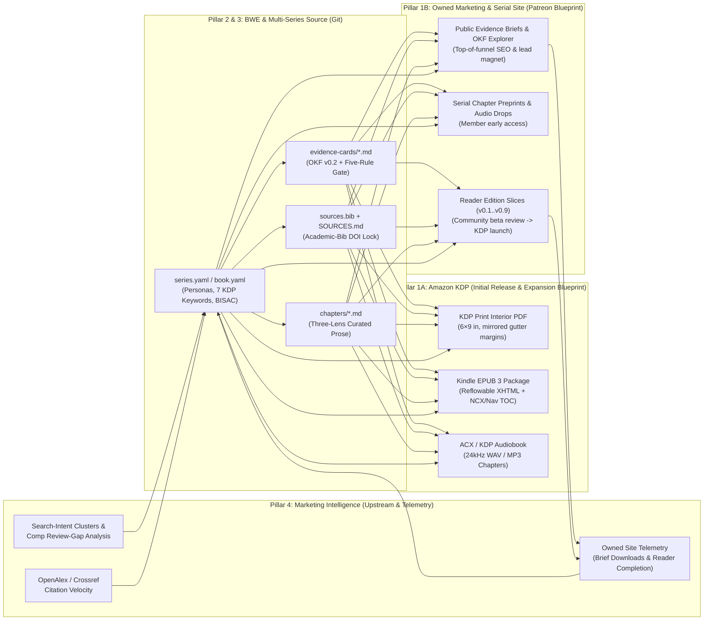

# Realized Press — Vision, Monetization, Book Writing Environment (BWE) & Marketing Intelligence

> **Linear Project (`P-ARC-18`):** [`Realized Press — Canonical Vision & Book Writing Environment (BWE)`](https://linear.app/realized/project/realized-press-canonical-vision-and-book-writing-environment-bwe-130eae5e23b7) (`fe68af35-3169-4d26-868e-0000a8d07672`) · [Canonical Vision Document](https://linear.app/realized/document/canonical-vision-monetization-bwe-multi-series-and-marketing-aecc83c9240e)

**Realized Press** (`ralfcam/realized-press`) operates on a four-pillar strategic thesis:
1. **Book Monetization & Owned Marketing Engine:**
   - **Amazon KDP as Initial Release Channel & Expansion Blueprint:** Producing high-trust, citation-locked nonfiction series launched first on **Amazon KDP** (Print-on-Demand 6"×9" Paperback/Hardcover, Kindle EPUB 3 eBook, ACX/KDP Audiobook) as the deterministic release blueprint for expanding to IngramSpark, Apple Books, Kobo, and direct storefronts.
   - **Internally Developed Marketing & Serial-Membership Site (Patreon Blueprint):** Treating the **Patreon** patronage/serial model as the architectural blueprint for an **owned, internally developed marketing and reader-community web site**—serving free *Public Evidence Briefs* and an interactive *OKF v0.2 Evidence Explorer* for top-of-funnel organic discovery, *Serial Chapter Preprints & Audio Drops*, and *Reader Edition (`v0.1`–`v0.9`)* beta feedback loops that drive KDP launches and direct recurring memberships.
2. **A Software & Agentic Product ("The Book Writing Environment" / BWE):** Treating book authoring with the rigor of the **Software Development Lifecycle (SDLC)** and modern **IDEs**—where claims have type-checked evidence cards, prose is linted against certainty grades, citations are cryptographically/DOI-locked against retractions, and manuscripts compile deterministically to every commercial and web format.
3. **Plug-and-Play Multi-Series Extensibility (`series/<slug>/`):** Declarative `series.yaml` manifests and one-command scaffolding (`scripts/init_series.py`) allow new book series and volumes to be added in seconds without changing the core harness.
4. **Marketing Intelligence & Data-Driven Topic Selection (`scripts/marketing_intelligence.py`):** Upstream and closed-loop market intelligence driving which series, books, and chapter anomalies get written—combining **Amazon KDP / BISAC category white-space & comp-review gap analysis**, **OpenAlex/Crossref academic citation velocity**, **search-intent topic clustering**, and **live lead-magnet conversion telemetry** from the owned marketing site.

---

## Closed-Loop Architecture Across All Four Pillars



---

## Pillar 1: KDP Initial Release Channel & Owned Marketing/Serial Site (Patreon Blueprint)

### 1. Amazon KDP — Initial Release Channel & Multi-Retailer Blueprint (`make kdp BOOK=...`)
- **KDP Print-on-Demand PDF (`--format kdp-6x9`):** 6" × 9" ($152.4 \times 228.6\text{ mm}$) trade-paperback interior with mirrored inside-gutter margins, embedded serif fonts, running headers, and automated `pypdf` blank-page and pagination verification.
- **Kindle eBook (`--epub`):** Valid EPUB 3 archive (`.epub`) with semantic XHTML chapters, embedded CSS typography, navigable TOC (`nav.xhtml`), and OPF metadata (`dc:title`, `dc:creator`, `dc:identifier`, `dc:language`).
- **Audiobook (`make audiobook-tts BOOK=...`):** Spoken-word transcript compilation (stripping footnotes, YAML frontmatter, and bibliography) + Gemini TTS synthesis per chapter.
- **Multi-Retailer Expansion Blueprint:** KDP is the initial commercial launch channel; because the 6"×9" interior PDFs, EPUB 3 packages, and 24kHz WAV/MP3 audio masters are built on open standards, the same build pipeline serves as the zero-rework blueprint for expanding to IngramSpark, Apple Books, Kobo, Google Play Books, and direct storefront fulfillment.

### 2. Internally Developed Marketing & Serial-Membership Site (Patreon Blueprint)
Rather than relying on third-party `patreon.com` hosting, Realized Press uses the **Patreon serial/tier model as the product blueprint for an internally developed marketing and reader-community web site** powered directly by the repository's OKF v0.2 and HTML/PDF build outputs:
- **Public Marketing & Lead Generation — *Public Evidence Briefs & Interactive OKF Explorer*:** Searchable web cards and 2-page downloadable PDFs distilled from `status: stable` OKF v0.2 Evidence Cards (e.g., *What We Know, What Remains Uncertain, and What This Does Not Mean*), capturing high-intent organic search traffic and converting readers to the newsletter and KDP book launches.
- **Core Member Tier — *Serial Chapter Preprints & Audio Drops*:** Chapter-by-chapter early web releases (`publishing/*-reader-edition.html`) paired with streamed chapter audio and behind-the-scenes research dossiers.
- **Insider / Practitioner Tier — *Reader Edition Releases (`v0.1`–`v0.9`) & Living Atlas*:** Complete private-circulation Reader Edition PDFs + structured reader feedback portals before retail KDP lock, plus full access to the underlying OKF v0.2 Evidence Card database and confounding-attenuation tables.

---

## Pillar 2: The AI Harness as a Product — "Book Writing Environment" (BWE)

Most AI writing tools are **prose generators** that accelerate hallucination and cliché. **Realized Press BWE** is an **Epistemic IDE & Book-SDLC Harness** built on a strict analogy between software engineering and serious nonfiction authoring:

| Software Engineering (SDLC / IDE) | Book Writing Environment (BDLC / BWE) | Realized Press Implementation |
| :--- | :--- | :--- |
| **Product Discovery & Market Telemetry** | **Marketing Intelligence & Topic Selection** | [`scripts/marketing_intelligence.py`](scripts/marketing_intelligence.py) + `series.yaml` (`marketing_intelligence`, comp-review gaps, citation velocity, KDP 7-slot keywords, lead-magnet ranking) |
| **Type System & Contracts** | **Atomic Evidence Cards (OKF v0.2)** | [`SPEC.md`](SPEC.md), [`templates/evidence-card-template.md`](templates/evidence-card-template.md) (`confidence` grade tokens, narrowest claim, mandatory `## What This Does Not Mean`) |
| **Package Lockfile (`package-lock.json`)** | **Verified Bibliographic Lock (`sources.bib` $\leftrightarrow$ `SOURCES.md`)** | [`scripts/mcp_academic_bib.py`](scripts/mcp_academic_bib.py) + [`scripts/sync_okf_sources.py`](scripts/sync_okf_sources.py) (Crossref, arXiv, OpenAlex DOIs) |
| **Unit Tests & CVE Vulnerability Scan** | **Five-Rule Promotion Gate & Live Retraction Audit** | [`scripts/five_rule_check.py`](scripts/five_rule_check.py) (`--online-retraction-check` queries Crossref `update-to` & OpenAlex `is_retracted`) |
| **Static Analysis & Linter (`eslint` / `ruff`)** | **Continuity, Metaphor, Footnote & Voice Linter** | [`scripts/audit_manuscript.py`](scripts/audit_manuscript.py) + [`style/forbidden-phrases.md`](style/forbidden-phrases.md) + Grade-to-Verb calibration (*shows* / *suggests* / *is associated with*) |
| **IDE Save Hooks & Pre-Commit Guards** | **Real-Time Agent Lifecycle Hooks** | [`.agents/hooks/post_edit_guard.py`](.agents/hooks/post_edit_guard.py) & [`.cursor/hooks/citation-check.py`](.cursor/hooks/citation-check.py) |
| **Multi-Target Release Build (`webpack` / `cargo`)** | **Deterministic Multi-Format Publishing Engine** | [`scripts/render_publishing_pdfs.py`](scripts/render_publishing_pdfs.py) (A4 Reader PDF, 6×9 KDP Print PDF, EPUB 3, Web HTML) + [`scripts/generate_audiobook_tts.py`](scripts/generate_audiobook_tts.py) |
| **Issue Tracker & Sprint Milestones** | **Editorial & Fact-Check Backlog (`ARC`)** | Linear MCP integration + [`.github/workflows/`](.github/workflows/) |

---

## Pillar 3: Plug-and-Play Multi-Series Architecture (`series/<slug>/`)

The repository is structured so that adding a **3rd, 4th, or $N$-th series or standalone book** requires zero changes to the core harness:
- **Declarative Series Manifest (`series/<series-slug>/series.yaml`):** Defines the series title, subtitle, author, Three-Lens triad, target chapter word-count bounds, KDP trim size (`6x9`), marketing intelligence metadata, and internal marketing/serial release cadence.
- **One-Command Series & Book Scaffolder (`scripts/init_series.py`):**
  ```bash
  python scripts/init_series.py --series "systems-of-trust" --title "Systems of Trust" --lenses "Mechanism,Institution,Ethics" --book "book-01-the-verification-gap"
  ```

---

## Pillar 4: Marketing Intelligence & Data-Driven Topic Selection (`make market-intel`)

Before a new series, book volume, or chapter is drafted—and continuously after it enters serial release—**Marketing Intelligence** ([`scripts/marketing_intelligence.py`](scripts/marketing_intelligence.py)) governs topic selection, positioning, and funnel optimization across three loops:

1. **Upstream Discovery — Selecting Series, Books & Chapter Anomalies:**
   - **Competitive Review-Gap Mining:** Identifies high-demand nonfiction categories where existing comp titles fail readers (`comp_title_gaps` in `series.yaml` — e.g., anecdotal pop-science without causal/genetic controls, or dry textbooks without organizational/human synthesis).
   - **Search-Intent & Question-Cluster Mapping:** Maps the exact high-intent questions practitioners and general readers search for (`high_intent_topic_clusters`) directly to chapter-level **Anomalies** and **OKF v0.2 Evidence Cards**.
   - **Bibliographic Velocity (`sources.bib` + OpenAlex/Crossref):** Balances foundational classics (1950s–2000s) with high-velocity frontier research (post-2020) so every book is both timeless and current.
2. **Midstream Packaging — KDP & Multi-Retailer Discoverability Gate:**
   - Audits **target personas**, **BISAC category codes**, and **7-slot Amazon KDP backend keyword phrases (`<=50` chars each)** (`6/6 checks passed` across both flagship series).
3. **Downstream Closed-Loop Telemetry (Owned Marketing Site $\to$ Editorial Prioritization):**
   - Automatically extracts the highest-leverage counter-intuitive/myth-busting hooks from `## What This Does Not Mean` across `status: stable` OKF v0.2 Evidence Cards to deploy as **Public Evidence Briefs** on the internal marketing site.
   - Uses search queries, Evidence Brief download velocity, and Reader Edition (`v0.1`–`v0.9`) chapter completion rates on the internal marketing site to prioritize which subsequent book volumes or new series to greenlight next.
